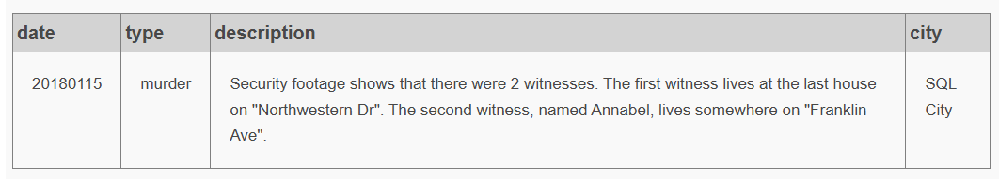
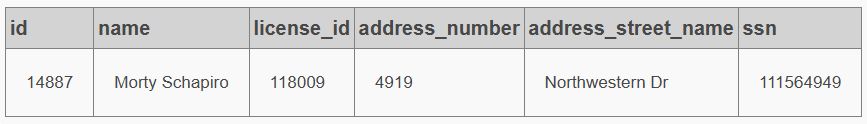
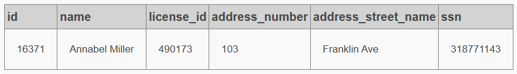
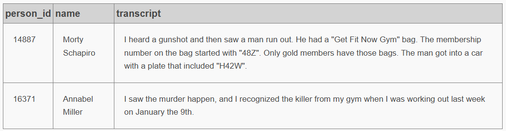
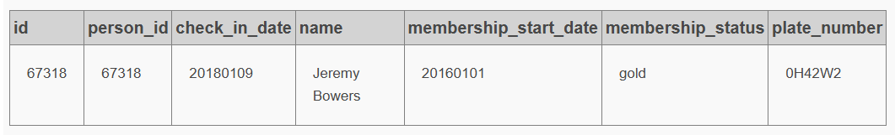
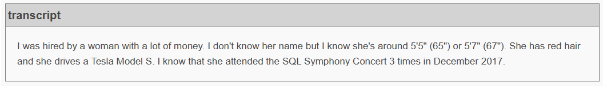
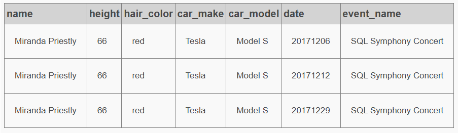
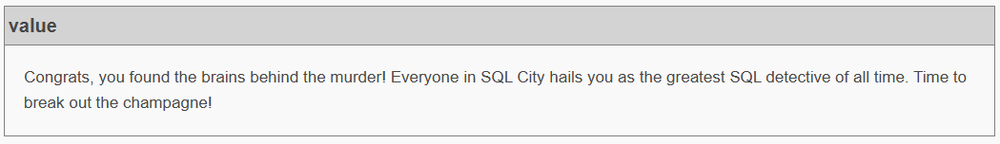

# SQL Murder Mystery Solution

## Overview

This documents my solution to the [SQL Murder Mystery](https://mystery.knightlab.com/)

The challenge involves investigating a fictional murder using SQL queries to analyse evidence, identify witnesses, examine suspects, and solve the case.


##  Investigation Process

### Step 1: Investigating the Crime Scene

I began by retrieving the crime scene report using the known information about the crime.

**SQL query:** 
```sql
SELECT *
FROM crime_scene_report                            
WHERE type = 'murder'
AND lower(city) = 'sql city'
AND date = 20180115;
```
View SQL script: [Crime Scene](1_murder_mystery/1_crime_scene.sql)


**Findings:** 

### Step 2: Identifying Witnesses

Using the information in the crime scene report, I queried the relevant tables to identify two witnesses.

**SQL query for the first witness:** 
```sql
SELECT 
	id,
	name,
	license_id,
	max(address_number) as address_number,
	address_street_name,
	ssn
FROM person
WHERE address_street_name = 'Northwestern Dr';
```

View full SQL script: [Two witnesses](1_murder_mystery/2_identify_witnesses.sql)

**Findings:** 


### Step 3: Investigating Interviews
To find out what the witnesses said during their interviews, joined the relevant tables and retrieve their interview transcripts.

**SQL query**
```sql
SELECT 
	person_id,
	name,
	transcript
FROM interview i
JOIN person p
	ON p.id = i.person_id
WHERE id = 14887 OR id = 16371;
```
SQL script: [Interviews](1_murder_mystery/3_investigating_interviews.sql)

**Findings**

 
### Step 4: Finding Suspects

I combined information from multiple tables to narrow down possible suspects.

**SQL Query:** 
```sql
SELECT 
	p.id,
	person_id,
	check_in_date,         
    p.name,
	membership_start_date,
	membership_status,
	plate_number
FROM get_fit_now_member m
JOIN get_fit_now_check_in c
	ON m.id = c.membership_id
JOIN person p
	ON m.person_id = p.id
JOIN drivers_license d
	ON p.license_id = d.id
WHERE check_in_date = 20180109
AND LOWER(membership_status) = 'gold'
AND plate_number like '%H42W%';
```
SQL query: [Investigating suspect](1_murder_mystery/4_investigating_suspect.sql)

**Findings:** 
<details>
<summary> Click to reveal the murder! (Spoiler)</summary>



</details>

<br>

I found the correct murder! However, there is more to this challenge
```
Congrats, you found the murderer! But wait, there's more... If you think you're up for a challenge, try querying the interview transcript of the murderer to find the real villain behind this crime. If you feel especially confident in your SQL skills, try to complete this final step with no more than 2 queries. Use this same INSERT statement with your new suspect to check your answer.
``` 

### Step 5: Solving the Mystery

After analysing the available evidence, I identified the culprit and verified my answer.

**SQL query** 

Click here to see: [Murder's interview transcript](1_murder_mystery/5_murders_interview_transcript.sql)

**Findings**


### Step 6: Final Investination

Based on the murderer's interview confession, the person behind the murder can be identified using the following query.

**SQL query**
```sql
SELECT
	p.name,
	height,
	hair_color,
	car_make,
	car_model,
	f.date,
	event_name
FROM person p
JOIN drivers_license d
	ON p.license_id = d.id
JOIN facebook_event_checkin f
	ON f.person_id = p.id
WHERE height = 66
AND LOWER(hair_color) = 'red'
AND LOWER(car_make) = 'tesla'
AND LOWER(car_model) = 'model s'
AND LOWER(event_name) = 'sql symphony concert'
AND f.date like '201712%';
```
SQL script: [Final Investigation](1_murder_mystery/6_final_investigation.sql)

<details>
<summary> Click to reveal the person behind the murder (Spoiler)</summary>



**The criminal mastermind:** Miranda Priestly

</details>

## Challenge Completed
After identifying the murderer and the mastermind behind the crime, I successfully solved the SQL Murder Mystery challenge. The message below confirms that the investigation is complete!



## Skills Demonstrated

- SQL querying and data retrieval
- Filtering data using `WHERE`
- Combining tables with `JOIN`
- Investigating relationships between datasets
- Translating evidence into logical SQL queries

## Key Takeaways

This challenge helped me develop my problem-solving skills by analysing clues, testing assumptions, and applying SQL queries to identify the culprit.

## Credits

Challenge : [Knight Lab SQL Murder Mystery](https://mystery.knightlab.com/)
